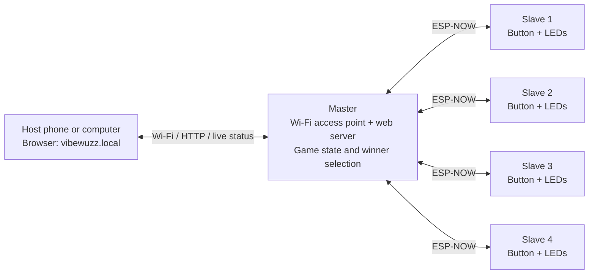
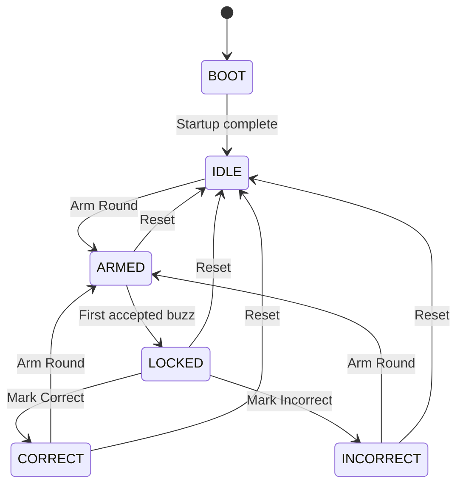
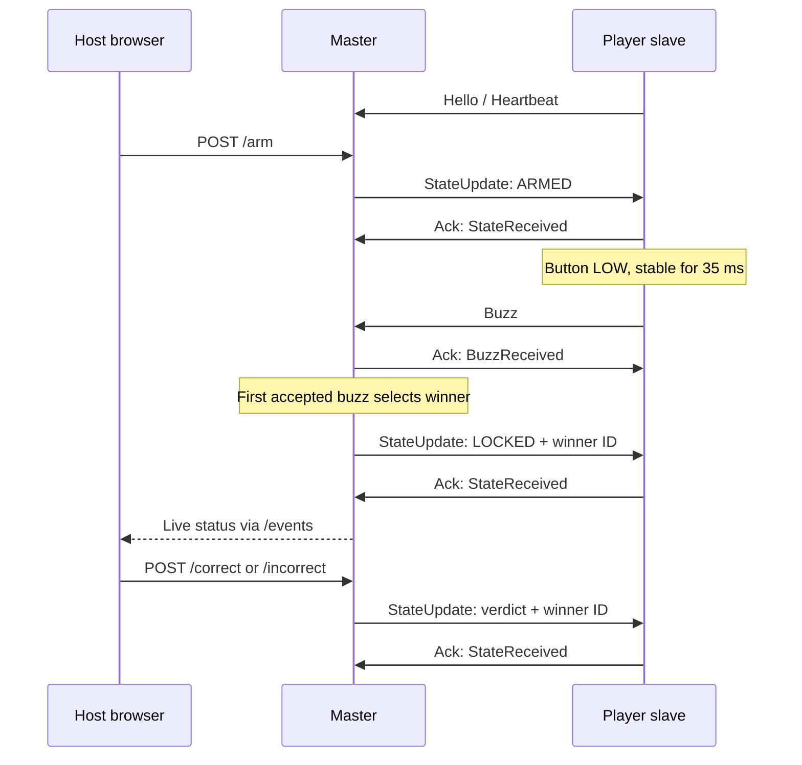

# Vibe Wuzz

A wireless quiz buzzer system with one master and up to four player buzzers. The host controls the game from a browser; the master selects the first received buzz and updates the player lights.

The master runs on an ESP32 Dev Module (default) or an ESP8266 D1 Mini Pro. Each slave runs on an ESP8266 D1 Mini Pro. Both firmware projects use Arduino through PlatformIO.

## System overview



- The master creates the **VibeWuzzMaster** Wi-Fi network and serves the controls at **http://vibewuzz.local**.
- The host joins that network. No router or internet connection is required.
- Slaves communicate directly with the master using **ESP-NOW on channel 1**. They do not join the access point as ordinary Wi-Fi clients.
- The master owns the game state. Player buzzes are accepted only while the round is armed.
- Bluetooth/BLE and an Expo app are **not implemented** in the current firmware.

## Repository layout

```text
wuzz/
├── README.md
├── master/
│   ├── platformio.ini
│   ├── src/master.cpp
│   └── include/
│       ├── buzzer_config.h
│       ├── buzzer_protocol.h
│       └── buzzer_logging.h
└── slave/
    ├── platformio.ini
    ├── src/client.cpp
    └── include/
        ├── buzzer_config.h
        ├── buzzer_protocol.h
        └── buzzer_logging.h
```

The root is one shared Git repository. `master/` and `slave/` remain independent PlatformIO projects. Each contains its own protocol header; keep packet layouts, enum values, and protocol versions compatible when changing either copy.

## Hardware and wiring

Typical setup:

- One ESP32 Dev Module for the master, or a D1 Mini Pro using the alternative master build.
- One to four D1 Mini Pro boards for the player buzzers.
- One normally open push button per slave.
- Six GRB, 800 kHz NeoPixels per board, matching the current configuration.
- An optional external armed indicator LED per slave, with a suitable series resistor.
- Suitable board and LED power supplies.

### Master connections

| Connection | ESP32 master | D1 Mini Pro master |
| --- | --- | --- |
| NeoPixel data input | GPIO4 | D2 / GPIO4 |
| Ready indicator | `LED_BUILTIN`, or GPIO2 fallback | `LED_BUILTIN`, or GPIO2 fallback |
| NeoPixel count | 6 | 6 |

The ready indicator is configured active-low and turns on after master initialization. The master has no physical game-control button in this firmware.

```text
ESP32 master                         NeoPixel strip / ring
GPIO4 -------- [data resistor] -----> DIN
GND -------------------------------- GND
                                      V+ <--- suitable LED supply
                                               |
ESP32 GND -------------------------------------+ supply GND

For a D1 Mini Pro master, use D2 instead of GPIO4.
```

### Slave connections

| Connection | D1 Mini Pro pin | Behavior |
| --- | --- | --- |
| Buzzer button | D1 / GPIO5 | Button to GND; internal pull-up enabled |
| NeoPixel data input | D2 / GPIO4 | Six GRB NeoPixels, 800 kHz |
| External armed LED | D3 / GPIO0 | HIGH while armed |
| Built-in LED | `LED_BUILTIN` | Active-low; on while armed |

```text
D1 Mini Pro slave

D1 / GPIO5 -------- normally open button -------- GND
                     closes when pressed

D2 / GPIO4 -------- [data resistor] -------------> NeoPixel DIN
GND -------------------------------------------- NeoPixel GND
                                                  NeoPixel V+ <-- LED supply
GND ------------------------------------------------------------ supply GND

D3 / GPIO0 -------- [LED resistor] --- LED anode
                                      LED cathode --- GND
```

These are signal wiring diagrams; choose supply voltage, current capacity, and resistors for your actual LEDs. Power NeoPixels from a suitable supply, not a GPIO. All components sharing signals need a common ground. For 5 V NeoPixels, use a suitable logic-level shifter if required by the strip's input specification.

D3/GPIO0 is also an ESP8266 boot-mode pin: external indicator wiring must allow it to remain HIGH during normal boot. The button pin used by the slave is defined in `slave/include/buzzer_config.h`; the master header's client defaults are not used to build the slave.

## Configure and pair the boards

Pairing uses configured station MAC addresses; there is no automatic enrollment screen.

1. Flash and start the master. Open its serial monitor at **115200 baud** and record **Master STA MAC**. Use the station MAC, not the AP MAC.
2. Set `kMasterMac` in `slave/include/buzzer_config.h` to that address.
3. Give each slave a unique `kClientId`, from **1 to 4**, in the same file. Build and upload separately for each board.
4. Start each slave and record **Client STA MAC** from its serial output.
5. In `master/include/buzzer_config.h`, update `kClientDefinitions` so each ID and label maps to the corresponding slave's station MAC. Rebuild and upload the master.
6. Keep `kEspNowChannel` identical in both projects. It is currently **1**.

The source contains prefilled MAC addresses; replace them with your boards' addresses, including placeholder entries for players 3 and 4 if you use those players.

Master configuration also defines:

| Setting | Current value |
| --- | --- |
| Access point SSID | `VibeWuzzMaster` |
| Access point password | `buzzmaster` |
| mDNS hostname | `vibewuzz` |
| Maximum players | 4, defined by `kMaxClients` in the protocol headers |

## Build and upload

Install PlatformIO and run the following commands from the repository root. Alternatively, open `master/` or `slave/` as a PlatformIO project in VS Code.

```sh
# Default master hardware: ESP32 Dev Module
pio run -d master -e master_esp32
pio run -d master -e master_esp32 -t upload
pio device monitor -b 115200

# Alternative master hardware: ESP8266 D1 Mini Pro
pio run -d master -e master_d1_mini_pro
pio run -d master -e master_d1_mini_pro -t upload

# Player buzzer: ESP8266 D1 Mini Pro
pio run -d slave -e client_d1_mini_pro
pio run -d slave -e client_d1_mini_pro -t upload
```

If multiple boards are connected, specify the desired device using `--upload-port` for upload and `--port` for the serial monitor. PlatformIO installs the configured Adafruit NeoPixel dependency during the build.

## Play a round

1. Power the master and configured slaves.
2. Connect your phone or computer to **VibeWuzzMaster**, using password **buzzmaster**.
3. Open **http://vibewuzz.local**. If the hostname does not resolve, use the **Master AP IP** printed in the master's serial monitor.
4. Check which players are online. You can edit player names in the web UI; names are saved in the master's EEPROM-backed storage.
5. Select **Arm Round**. The slaves turn blue and enable their armed indicators.
6. A player presses their button. The first valid buzz received by the master locks the round and selects that player. Later buzzes cannot replace the winner.
7. Select **Mark Correct** or **Mark Incorrect**. The winning slave shows a green or red animation; the other slaves go dark.
8. Select **Arm Round** for another round, or **Reset** to return to idle.

The browser enables Arm from Idle, Correct, or Incorrect; it enables verdict buttons while Locked. Incorrect does not automatically reopen the round or exclude the previous winner.

### Game states



### LED feedback

| State | Master strip | Slave strips |
| --- | --- | --- |
| Boot | Orange | Blue startup breathing, then searching animation until master seen |
| Idle | Green | Off |
| Armed | Blue | Blue; armed indicators on |
| Locked | Purple | Purple |
| Correct | Green | Winner: green animation; others off |
| Incorrect | Red | Winner: red animation; others off |

A slave plays a brief green animation when it first detects the master. Its searching animation represents initial discovery; the firmware does not currently restart this animation when a previously seen master disappears.

## Communication flow



State updates are sent individually to all four configured peers. Packets include a protocol version, role, sender/target IDs, sequence and acknowledgement numbers, state, winner ID, and uptime. Master ID is `0`; no winner is represented internally by `0xFF` and as `null` in the web status.

Both sides send Hello probes every **2 seconds** and Heartbeats every **3 seconds**. The master marks a slave offline after **10 seconds** without a valid received packet. State updates are acknowledged, and pending updates are retried at **250 ms** intervals. A slave sends a buzz once per armed period; it does not retry the buzz if the packet is lost. Winner selection follows master receive order, rather than synchronized button timestamps.

## Web interface

| Method | Path | Purpose |
| --- | --- | --- |
| GET | `/` | Host control page |
| GET | `/status` | JSON game state, winner, and client status |
| GET | `/events` | Server-Sent Events stream for live status |
| POST | `/arm` | Arm and clear the previous winner |
| POST | `/correct` | Mark the locked winner correct |
| POST | `/incorrect` | Mark the locked winner incorrect |
| POST | `/reset` | Return to idle and clear the winner |
| POST | `/names` | Save form fields `label1` through `label4` |

The live stream supports two simultaneous browser connections. The page falls back to one-second status polling when the stream fails or EventSource is unavailable. Control actions return an HTTP redirect to `/`.

## Troubleshooting and current limitations

- **Player stays offline:** check both station MAC configurations, unique player IDs, matching channels, and the 115200-baud logs. The master rejects unknown sender MAC addresses.
- **Button does nothing:** check the D1-to-GND wiring and arm the round first. A button already held down when armed can also trigger a buzz after debounce; release it between rounds.
- **Hostname does not work:** stay connected to the master's Wi-Fi and use its serial-reported AP IP instead.
- **Lights behave incorrectly:** check LED type, count, DIN direction, supply capacity, and common ground.
- **Master restarts during play:** restart slaves too if they stop applying updates. Slaves reject state sequence numbers older than the last applied update, and the master's sequence counter starts again after reboot.
- The code does not currently provide scores, automatic rearming after an incorrect answer, or Bluetooth control.
- ESP-NOW peers are configured without encryption, and the web routes have no application-level authentication. The access point password controls Wi-Fi access.
